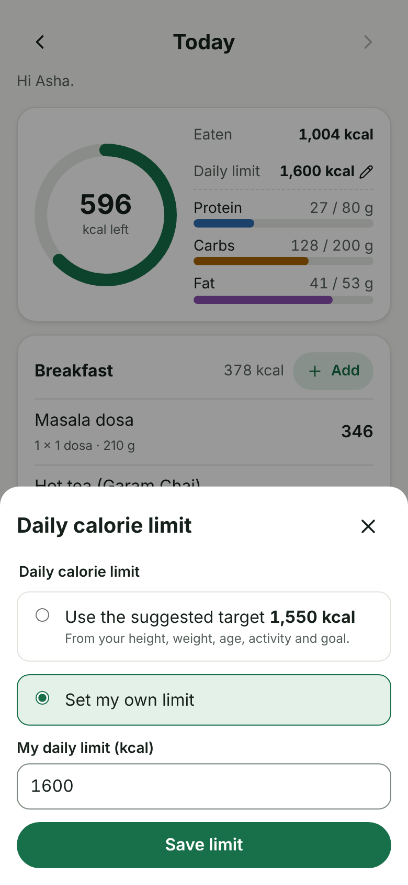
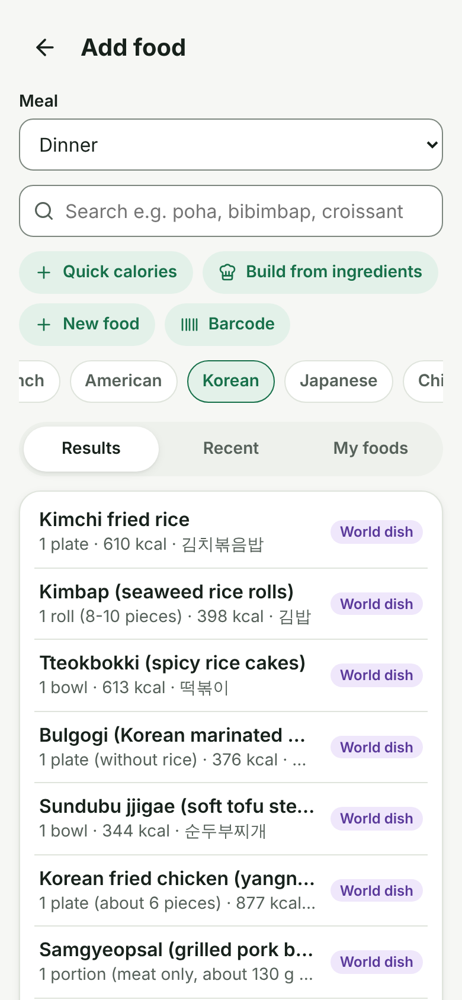
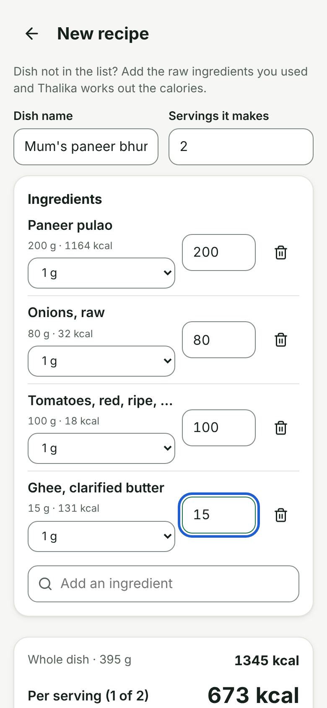

# Thalika

A free calorie tracker for Indian, French, American and world food. Android app and desktop app (Windows, macOS, Linux) from one codebase.

- **Daily diary** by meal: calories left, protein, carbs and fat. The target is worked out from your body and goal, or **set your own daily limit** (tap the target on the diary).
- **17,814 foods on the device**, per 100 g with household portions, filterable by cuisine (Indian, French, American, Korean, Japanese, Chinese, Thai, Vietnamese, Italian, Mexican, Middle Eastern, Greek, Spanish):
  - Indian Nutrient Databank (INDB): 1,014 Indian dishes
  - ANSES-CIQUAL: 3,341 French foods
  - USDA FNDDS survey foods: 5,624 American foods as eaten
  - USDA SR Legacy: 7,793 basic foods and ingredients
  - 42 world dishes the open tables lack (bulgogi, japchae, gyoza, tonkatsu, massaman, banh mi, shawarma...), computed from USDA ingredients using typical home recipes (`data/world_recipes.json`)
- **Build a dish from raw ingredients**: add each ingredient and its amount, say how many servings it makes, and get kcal per serving. Saved under My foods to log again, edit or delete.
- **Metric or imperial**: kg/cm or lb/ft+in for height and weight.
- Packaged foods and barcodes from Open Food Facts (optional), quick calories, your own foods, water, weight, 7/30-day progress, backup/restore, delete everything.
- No account, no server. Your diary stays on your device.

| Diary | Daily limit | Korean dishes | Build from ingredients |
|---|---|---|---|
|  |  |  |  |

## Get the app
Every push builds the apps in GitHub Actions. Open the latest **Build** run under the Actions tab and download:
- `thalika-android-apk`: unzip, copy the `.apk` to your phone, open it and allow "install unknown apps".
- `thalika-desktop-Windows` / `-macOS` / `-Linux`: installers (unsigned, so your OS will warn the first time).

Tag a version (`git tag v0.1.0 && git push --tags`) to get a draft GitHub release with all files attached.

## Develop
```bash
npm ci
npm run dev           # browser preview at http://localhost:5173
npm test              # unit tests
npm run build && npm run e2e   # end-to-end tests (Playwright)
npm run desktop       # run the desktop app
npm run android:sync  # copy the build into android/, then open android/ in Android Studio
```

### Rebuild the food table
```bash
scripts/fetch_sources.sh ../data-src      # downloads the open datasets
npm run db -- --src ../data-src           # writes public/data/foods.json
```

## Layout
- `src/`: the app (React + TypeScript). `src/lib/` has the logic: food search, targets, units, storage, the Android back button.
- `public/data/foods.json`: the food table.
- `android/`: Capacitor Android project. `electron/`: desktop shell.
- `scripts/`: data build, icons, screenshots.
- `replica/`: research and planning notes (recon, architecture, design, tests, parity, reviews, brand, launch, deploy).

## Licences
Code: MIT (`LICENSE`). Food data: see `DATA_LICENSES.md`. Privacy: `PRIVACY.md`.

Thalika is a food diary, not medical advice.
